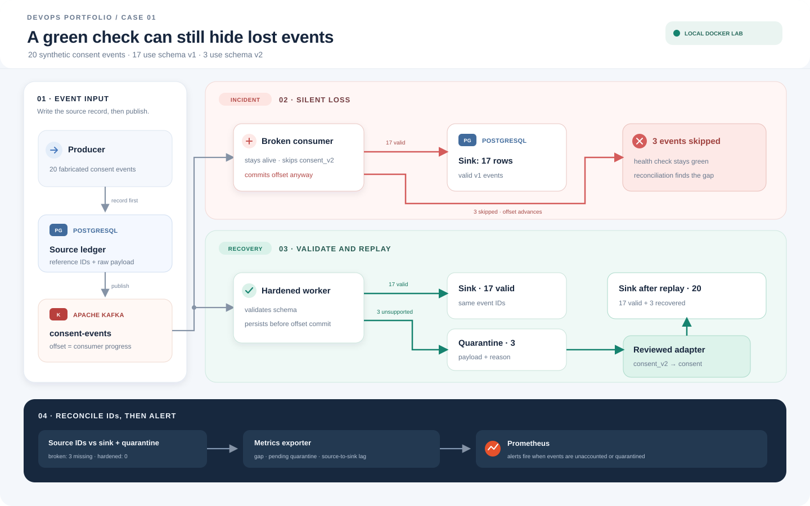
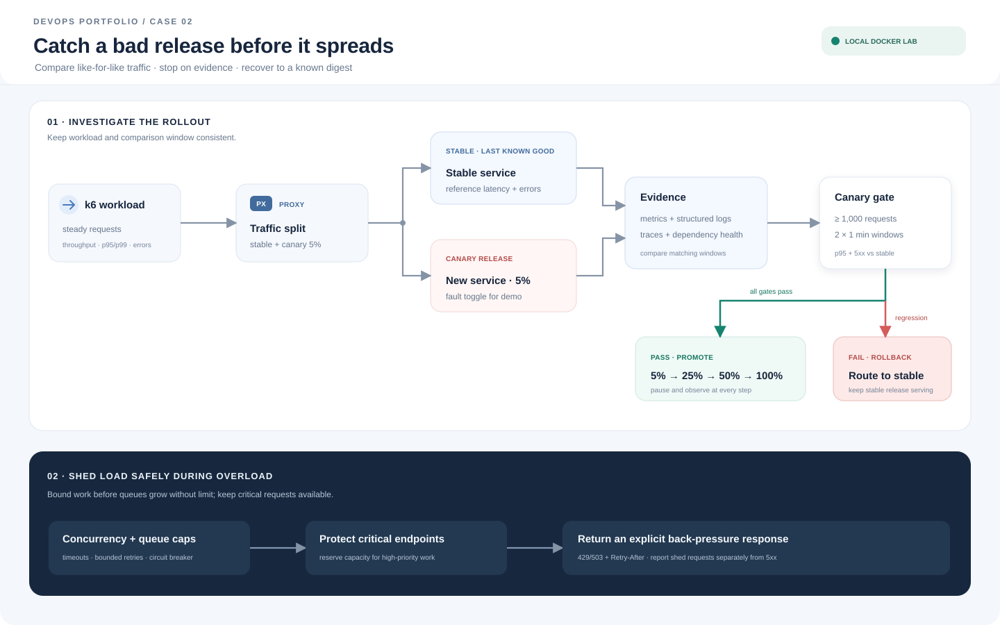
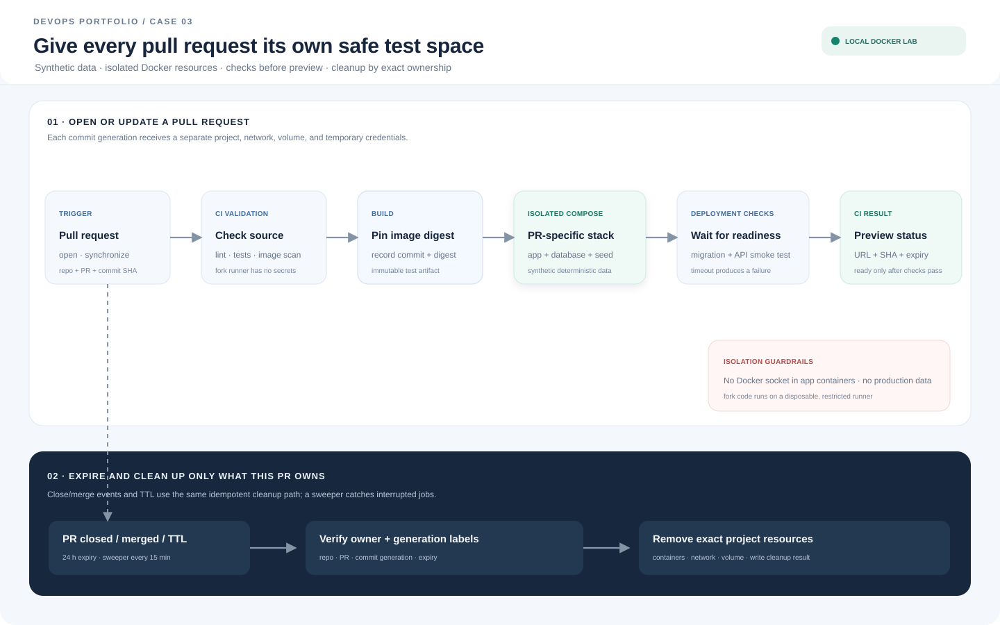
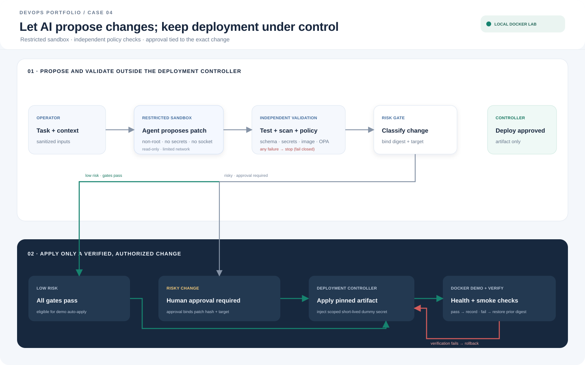

<div align="center">

# DevOps Practice Labs

**Four Docker-based study cases for reliability, delivery, and operations.**

Reproducible local environments with synthetic data. Run a case, observe its behavior, and reset it when you are done.

[English](#english) · [Bahasa Indonesia](#bahasa-indonesia) · [Study cases](#study-cases) · [Quick start](#quick-start)

</div>

<a id="english"></a>

## About these labs

This repository contains four hands-on DevOps study cases. Each case focuses on an operational problem and includes a runnable Docker Compose lab, implementation files, diagrams, and supporting documentation. The labs run locally and create no cloud resources. They are learning environments, not production deployments.

**Looking for tool references?** The [DevOps Tools Reference](case-00-devops-foundations/README.md) maps common tools to their roles, shows which ones are present here, and links to official usage documentation.

**Choose a setup path:** Use [Docker Compose](docs/learning-paths.md) for the local labs. Case 02 also has optional [Kubernetes manifests](case-02-incident-recovery/docs/kubernetes.md). If you use an AI assistant, follow [Learning with AI](docs/learning-with-ai.md).

## Study cases

<table>
  <tr>
    <td align="center" width="50%">
      <a href="case-01-silent-data-loss/docs/build-and-run.md"></a>
      <br><strong>01 · Silent data loss</strong><br>
      Detect schema drift, quarantine invalid events, reconcile IDs, and replay safely.<br>
      <sub>Stack: Kafka · PostgreSQL · Python · Prometheus</sub><br>
      <sub><a href="case-01-silent-data-loss/docs/build-and-run.md">Build and run</a> · <a href="case-01-silent-data-loss/docs/test-evidence.md">Test evidence</a></sub>
    </td>
    <td align="center" width="50%">
      <a href="case-02-incident-recovery/docs/build-and-run.md"></a>
      <br><strong>02 · Incident recovery</strong><br>
      Investigate latency and errors, gate a canary, roll back, and shed load.<br>
      <sub>Stack: Python · PostgreSQL · Prometheus · k6</sub><br>
      <sub><a href="case-02-incident-recovery/docs/build-and-run.md">Build and run</a> · <a href="case-02-incident-recovery/docs/test-evidence.md">Load-test evidence</a> · <a href="case-02-incident-recovery/docs/kubernetes.md">Kubernetes path</a></sub>
    </td>
  </tr>
  <tr>
    <td align="center" width="50%">
      <a href="case-03-developer-platform/docs/build-and-run.md"></a>
      <br><strong>03 · Developer platform</strong><br>
      Provision isolated pull request previews with synthetic data and scoped cleanup.<br>
      <sub>Stack: Python · Docker Compose · PostgreSQL</sub><br>
      <sub><a href="case-03-developer-platform/docs/build-and-run.md">Build and run</a> · <a href="case-03-developer-platform/docs/test-evidence.md">Isolation and cleanup evidence</a></sub>
    </td>
    <td align="center" width="50%">
      <a href="case-04-safe-ai-deployment/docs/build-and-run.md"></a>
      <br><strong>04 · Safe AI deployment</strong><br>
      Sandbox proposed changes, enforce policy, limit secrets, and gate risky actions.<br>
      <sub>Stack: Docker Compose · OPA · Python</sub><br>
      <sub><a href="case-04-safe-ai-deployment/docs/build-and-run.md">Build and run</a> · <a href="case-04-safe-ai-deployment/docs/test-evidence.md">Policy and rollback evidence</a></sub>
    </td>
  </tr>
</table>

Case 04 uses fixed proposal fixtures to demonstrate guarded deployment; it does not call an AI model. The cases use synthetic records and disposable demo credentials.

## Quick start

### Requirements

- Docker Desktop or Docker Engine with the Docker Compose plugin.
- Python 3 for the host-side control commands in Cases 02 and 03.
- Internet access to download container images on the first run.

Start Docker first, then run commands from the relevant case directory. Validate a Compose configuration with `docker compose config` before starting it.

| Case | Start the lab | Full guide |
| --- | --- | --- |
| 01 · Silent data loss | `cd case-01-silent-data-loss` then `docker compose up -d --build` | [Build and run](case-01-silent-data-loss/docs/build-and-run.md) |
| 02 · Incident recovery | `cd case-02-incident-recovery` then `docker compose up -d --build` | [Build and run](case-02-incident-recovery/docs/build-and-run.md) |
| 03 · Developer platform | `cd case-03-developer-platform` then `python3 envctl.py provision --pr 42 --generation 1 --port 18421` | [Build and run](case-03-developer-platform/docs/build-and-run.md) |
| 04 · Safe AI deployment | `cd case-04-safe-ai-deployment` then `docker compose up -d --build volume-init opa target` | [Build and run](case-04-safe-ai-deployment/docs/build-and-run.md) |

Case 01 needs an additional seed command and the other cases have scenario-specific steps. Follow each guide for the complete sequence, expected behavior, service URLs, and troubleshooting.

## Why Docker?

- **No cloud bill for these labs:** the Compose stacks create local containers and networks, not cloud resources. Docker still uses local CPU, memory, disk, electricity, and bandwidth to download images and run services.
- **Separate lab dependencies:** each case runs as its own Compose project. Databases and brokers do not need to be installed globally, and the documented cleanup targets the lab project.
- **Repeatable setup:** Compose files declare services and configuration so the environment can be rebuilt consistently.
- **Disposable practice data:** synthetic records and demo credentials can be removed with the lab's cleanup instructions.

Containers share the host kernel. These labs provide useful local separation, but are not a security boundary for hostile code or a substitute for production infrastructure.

## Results and cleanup

Evidence and limitations are documented with each case. Start with the [Case 02 load-test results](case-02-incident-recovery/docs/test-evidence.md), [Case 03 isolation and cleanup results](case-03-developer-platform/docs/test-evidence.md), or [Case 04 policy, approval, and rollback results](case-04-safe-ai-deployment/docs/test-evidence.md).

For Cases 01, 02, and 04, run this from the case directory to stop containers and remove that lab's named volumes:

```sh
docker compose down --volumes --remove-orphans
```

For Case 03, use its environment manager so cleanup targets the requested preview:

```sh
python3 envctl.py cleanup --pr 42
```

These commands remove lab data. Check the case guide for persistence behavior and cleanup scope before running them.

## License

Original code and documentation in this repository are licensed under the [MIT License](LICENSE). Third-party tools and container images remain subject to their own licenses and terms.

<a id="bahasa-indonesia"></a>

## Bahasa Indonesia

# DevOps Practice Labs

**Empat study case berbasis Docker untuk keandalan, delivery, dan operasi.**

Environment lokal yang dapat diulang dengan data sintetis. Jalankan satu case, amati perilakunya, lalu bersihkan setelah selesai.

## Tentang lab ini

Repository ini berisi empat study case praktik DevOps. Setiap case membahas masalah operasional dan menyediakan lab Docker Compose, file implementasi, diagram, serta dokumentasi pendukung yang dapat dijalankan. Lab berjalan secara lokal dan tidak membuat resource cloud. Ini adalah environment belajar, bukan deployment produksi.

**Mencari referensi tools?** [Referensi Tools DevOps](case-00-devops-foundations/README.md) memetakan fungsi kategori tools, menunjukkan mana yang tersedia di sini, dan menyediakan tautan dokumentasi penggunaan resmi.

**Pilih jalur setup:** Gunakan [Docker Compose](docs/learning-paths.md) untuk menjalankan lab lokal. Case 02 juga menyediakan [manifest Kubernetes opsional](case-02-incident-recovery/docs/kubernetes.md). Jika menggunakan asisten AI, ikuti panduan [Belajar dengan AI](docs/learning-with-ai.md).

## Daftar study case

| Case | Skenario dan komponen | Panduan |
| --- | --- | --- |
| 01 · Kehilangan data senyap | Deteksi schema drift, karantina event tidak valid, rekonsiliasi ID, dan replay dengan aman. **Stack:** Kafka · PostgreSQL · Python · Prometheus | [Build dan jalankan](case-01-silent-data-loss/docs/build-and-run.md) · [Bukti test](case-01-silent-data-loss/docs/test-evidence.md) |
| 02 · Pemulihan insiden | Investigasi latensi/error, gate canary, rollback, dan load shedding. **Stack:** Python · PostgreSQL · Prometheus · k6 | [Build dan jalankan](case-02-incident-recovery/docs/build-and-run.md) · [Bukti load test](case-02-incident-recovery/docs/test-evidence.md) · [Jalur Kubernetes](case-02-incident-recovery/docs/kubernetes.md) |
| 03 · Platform developer | Preview pull request terisolasi dengan data sintetis dan cleanup terbatas. **Stack:** Python · Docker Compose · PostgreSQL | [Build dan jalankan](case-03-developer-platform/docs/build-and-run.md) · [Bukti isolasi dan cleanup](case-03-developer-platform/docs/test-evidence.md) |
| 04 · Deployment AI yang aman | Sandbox proposal perubahan dengan pemeriksaan policy dan gate approval. **Stack:** Docker Compose · OPA · Python | [Build dan jalankan](case-04-safe-ai-deployment/docs/build-and-run.md) · [Bukti policy dan rollback](case-04-safe-ai-deployment/docs/test-evidence.md) |

Case 04 menggunakan fixture proposal tetap untuk mendemonstrasikan deployment dengan guardrail; case ini tidak memanggil model AI. Semua record dan kredensial demo bersifat sintetis atau sementara.

## Mulai cepat

### Prasyarat

- Docker Desktop atau Docker Engine dengan plugin Docker Compose.
- Python 3 untuk perintah kontrol dari host pada Case 02 dan 03.
- Akses internet untuk mengunduh image container saat pertama kali dijalankan.

Jalankan Docker terlebih dahulu, lalu jalankan perintah dari direktori case yang sesuai. Periksa konfigurasi dengan `docker compose config` sebelum memulai service.

| Case | Mulai lab | Panduan lengkap |
| --- | --- | --- |
| 01 · Kehilangan data senyap | `cd case-01-silent-data-loss` lalu `docker compose up -d --build` | [Build dan jalankan](case-01-silent-data-loss/docs/build-and-run.md) |
| 02 · Pemulihan insiden | `cd case-02-incident-recovery` lalu `docker compose up -d --build` | [Build dan jalankan](case-02-incident-recovery/docs/build-and-run.md) |
| 03 · Platform developer | `cd case-03-developer-platform` lalu `python3 envctl.py provision --pr 42 --generation 1 --port 18421` | [Build dan jalankan](case-03-developer-platform/docs/build-and-run.md) |
| 04 · Deployment AI yang aman | `cd case-04-safe-ai-deployment` lalu `docker compose up -d --build volume-init opa target` | [Build dan jalankan](case-04-safe-ai-deployment/docs/build-and-run.md) |

Case 01 memerlukan perintah seed tambahan; case lainnya juga punya langkah skenario khusus. Ikuti panduan masing-masing untuk urutan lengkap, hasil yang diharapkan, URL service, dan troubleshooting.

## Mengapa Docker?

- **Tidak ada tagihan cloud untuk lab ini:** Compose membuat container dan network lokal, bukan resource cloud. Docker tetap menggunakan CPU, memori, penyimpanan, listrik, dan bandwidth lokal untuk mengunduh image dan menjalankan service.
- **Dependency lab terpisah:** tiap case berjalan sebagai Compose project sendiri. Database dan message broker tidak perlu dipasang global, dan perintah cleanup dibatasi pada project lab.
- **Setup konsisten:** file Compose mendeklarasikan service dan konfigurasi agar environment dapat dibangun ulang dengan cara yang sama.
- **Data latihan mudah dibuang:** record sintetis dan kredensial demo dapat dihapus sesuai instruksi cleanup tiap lab.

Container berbagi kernel host. Lab ini memberi pemisahan lokal yang berguna, tetapi bukan batas keamanan untuk kode berbahaya atau pengganti infrastruktur produksi.

## Hasil dan cleanup

Bukti dan batasan dicatat di masing-masing case. Lihat [hasil load test Case 02](case-02-incident-recovery/docs/test-evidence.md), [hasil isolasi dan cleanup Case 03](case-03-developer-platform/docs/test-evidence.md), atau [hasil policy, approval, dan rollback Case 04](case-04-safe-ai-deployment/docs/test-evidence.md).

Untuk Case 01, 02, dan 04, jalankan perintah berikut dari direktori case untuk menghentikan container dan menghapus named volume lab tersebut:

```sh
docker compose down --volumes --remove-orphans
```

Untuk Case 03, gunakan environment manager agar cleanup hanya menghapus preview yang dipilih:

```sh
python3 envctl.py cleanup --pr 42
```

Perintah ini menghapus data lab. Periksa panduan case untuk memahami data persisten dan cakupan cleanup sebelum menjalankannya.

## Lisensi

Kode dan dokumentasi asli dalam repository ini menggunakan [MIT License](LICENSE). Tool dan image container pihak ketiga tetap mengikuti lisensi serta ketentuannya masing-masing.
