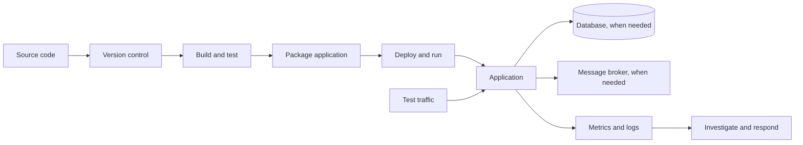

# DevOps Tools Reference

[English](#english) | [Bahasa Indonesia](#bahasa-indonesia)

## A tool map for the study cases

These hands-on study cases use tools from several parts of the DevOps ecosystem. This page is a reference map: it names common tools, explains the jobs they address, distinguishes tools present in this workspace from examples, and links to selected official documentation. It is not a prerequisite course or a step-by-step beginner tutorial.

You do not need to learn every product below. Learn the job each category does, then choose one tool for that job. Similar tools often overlap; the right choice depends on the system, team, cost, and operational needs.

## Tool names used across the ecosystem

| Learning stage | Tools | What to learn first | In this workspace |
| --- | --- | --- | --- |
| Core | Linux shell, Git, GitHub, Docker, Docker Compose | Navigate files, inspect changes, build an image, run containers, and read logs. | Git, Dockerfiles, and Compose projects are used. |
| App and support services | PostgreSQL, Kafka, Redis; Prometheus, Grafana, Loki, OpenTelemetry; pytest, k6 | Understand databases, message queues, metrics, logs, traces, and repeatable tests. | PostgreSQL, Kafka, Prometheus, Python tests, and k6 are used. Redis, Grafana, Loki, and OpenTelemetry are examples only. |
| Delivery and infrastructure | GitHub Actions, GitLab CI, Jenkins; Kubernetes, kubectl, Helm, Argo CD; Terraform/OpenTofu, Ansible | Automate build and deployment, orchestrate containers, and provision infrastructure when needed. | Optional Kubernetes YAML is included; CI pipelines, Helm charts, Argo CD, Terraform, and Ansible are not configured. |
| Security and policy | Trivy, OPA, Vault, cloud secret managers | Scan images, enforce rules, and manage real credentials with access controls. | OPA is used in a local demonstration. Trivy and a real secret manager are not configured. |

The list is a reference, not a requirement to install every tool. Use the workspace status column to see what the study cases actually run. The detailed guides introduce selected tools in context; the official documentation below is the source for each product's full usage and configuration reference.

## A simple delivery path

This is a teaching model, not a requirement that every system use every component. A small web app may need only Git, a build, an application, a database, and basic monitoring. A high-volume event system may also need a broker, traffic controls, and more detailed observability.

## The tool landscape

| Job to do | What it means | Common tools | Available in this workspace |
| --- | --- | --- | --- |
| Track source changes | Review, compare, and recover code changes | Git; GitHub, GitLab, Bitbucket | Git repository; no automated CI workflow is included. |
| Operate a host | Work with operating systems, shells, remote access, and service processes | Linux (Ubuntu, Debian, RHEL), Bash, Zsh, SSH, systemd | Docker runs on the host; host administration is outside the labs. |
| Plan work and review changes | Track issues, tasks, discussions, and code reviews | GitHub Issues and Projects, GitLab Issues, Jira, Linear, Azure Boards | Not configured as part of these local labs. |
| Build and test | Run checks automatically when code changes | GitHub Actions, GitLab CI, Jenkins | Commands and tests are documented; CI runners are not configured here. |
| Build software | Compile, package, or orchestrate language-specific builds | Make, Maven, Gradle, npm, pnpm, Poetry, uv | Python project commands are documented; no shared build server is configured. |
| Store and distribute artifacts | Keep versioned packages and container images | GitHub Packages, Harbor, JFrog Artifactory, Sonatype Nexus, AWS ECR, Azure Container Registry, Google Artifact Registry | Local images are used; no registry is required. |
| Check code quality and dependencies | Find style issues, bugs, vulnerable dependencies, or exposed secrets | Ruff, ESLint, SonarQube, Dependabot, Renovate, Trivy, Gitleaks | Not configured as a common CI pipeline. OPA is used in a local policy demonstration. |
| Package an application | Bundle code and runtime dependencies consistently | Docker, Buildah; image registries such as GHCR or ECR | Dockerfiles and local Docker images. No registry is required. |
| Run containers | Start and isolate container processes on one machine | Docker Engine, containerd, Podman | Docker is the documented runtime; Podman is an alternative. |
| Run containers locally | Start an app and its dependencies together | Docker Compose, Podman Compose | Docker Compose YAML is used throughout the local exercises. |
| Orchestrate containers | Schedule, restart, scale, and connect workloads in a cluster | Kubernetes; managed services such as EKS, GKE, AKS | Optional Kubernetes manifests are included; a cluster is not bundled. |
| Manage Kubernetes applications | Template, reconcile, and progressively deliver cluster configuration | Helm, Kustomize, Argo CD, Flux, Spinnaker | Optional manifests are included; no GitOps controller or Helm chart is configured. |
| Connect services in a cluster | Apply service-to-service routing, identity, and traffic policy | Istio, Linkerd, Consul | Not included; service mesh is an advanced option, not a container prerequisite. |
| Package Kubernetes configuration | Reuse and parameterize Kubernetes resources | Helm, Kustomize | Kustomize can render the optional manifests; no Helm chart is included. |
| Provision infrastructure | Create networks, compute, storage, and cloud resources as code | Terraform, OpenTofu, AWS CloudFormation | Not included; these local exercises create no cloud resources. |
| Configure existing machines | Install packages and apply host configuration repeatedly | Ansible, cloud-init | Not included. |
| Run workloads in a cloud | Choose compute, managed databases, storage, and networking | AWS, Microsoft Azure, Google Cloud, DigitalOcean, Oracle Cloud Infrastructure | Not included; labs run locally and create no cloud resources. |
| Manage cloud-native infrastructure | Define resources with a cloud provider's native tools or APIs | AWS CDK, Pulumi, Crossplane, AWS CloudFormation, Bicep | Not included. |
| Run event-driven or serverless workloads | Execute functions or containers in response to events without managing every host | AWS Lambda, Azure Functions, Google Cloud Run, Knative, OpenFaaS | Not included. |
| Connect and protect network traffic | Resolve names, terminate TLS, route traffic, and filter requests | DNS providers, cert-manager, Nginx, Traefik, HAProxy, Envoy, cloud load balancers, cloud firewalls | A small application router is used in a lab; public DNS, TLS automation, and cloud networking are not configured. |
| Publish APIs and edge traffic | Apply API authentication, quotas, routing, caching, or edge protection | Kong, Apache APISIX, Envoy Gateway, AWS API Gateway, Cloudflare, Fastly | Not included. |
| Store application data | Keep durable structured or unstructured state | PostgreSQL, MySQL, SQLite, object storage | PostgreSQL is used in local exercises. |
| Buffer asynchronous work | Let producers and consumers exchange events without running in lockstep | Kafka, RabbitMQ, cloud queues | Kafka is used in one local exercise. |
| Cache frequently used data | Reduce repeated work when cached data can be rebuilt or expired | Redis, Memcached | No cache service is included. A cache is optional and must have a clear freshness strategy. |
| Route network traffic | Terminate TLS, route requests, or balance traffic across app instances | Nginx, Traefik, HAProxy, cloud load balancers | An application router demonstrates release weighting in one exercise; no general ingress controller is included. |
| Observe behavior | Collect measurements and help operators investigate changes | Prometheus (metrics), Grafana (dashboards), Loki or OpenSearch (logs), OpenTelemetry (traces) | Prometheus and a small metrics exporter are included in selected exercises. Grafana, centralized logs, and distributed tracing are not configured. |
| Monitor with a hosted service | Send telemetry to a managed observability platform | Datadog, New Relic, Dynatrace, Splunk Observability, Grafana Cloud | Not included; the exercises keep observability local. |
| Respond to incidents | Coordinate alerts, ownership, escalation, and incident notes | PagerDuty, Opsgenie, Grafana OnCall, incident.io | Not configured; alert rules in a lab demonstrate signals, not an on-call service. |
| Generate test traffic | Check an API or apply controlled load | pytest, curl, k6 | Smoke checks, curl examples, and k6 load profiles are included where relevant. |
| Test reliability under failure | Introduce controlled faults or validate recovery behavior | Toxiproxy, Chaos Mesh, LitmusChaos, Gremlin | Selected labs provide deterministic faults; no general chaos platform is configured. |
| Control releases and features | Gradually enable a feature or route traffic between versions | LaunchDarkly, Unleash, OpenFeature, Argo Rollouts, Flagger | Release routing is demonstrated locally in one exercise; no feature-flag service is configured. |
| Scan and enforce rules | Find known image issues or block changes that violate policy | Trivy, OPA, policy-as-code tools | OPA is used in a local policy exercise; Trivy and CI security scanning are not configured. |
| Manage identity and secrets | Authenticate workloads and store credentials with access controls and rotation | HashiCorp Vault, AWS Secrets Manager, Azure Key Vault, Google Secret Manager, External Secrets Operator, SPIFFE/SPIRE | Only disposable demo values are used. No real secret manager or workload identity provider is included. Kubernetes Secret objects alone do not encrypt a value in every storage or backup configuration. |
| Back up and restore data | Create recoverable copies and verify restoration procedures | pg_dump, pgBackRest, Velero, cloud backup services | Lab data is disposable; production backup systems are not included. |
| Manage cloud cost | Attribute, forecast, and optimize infrastructure spending | Infracost, cloud cost-management tools, provider billing dashboards | No cloud resources or cloud billing integrations are configured. |

“Available” describes what this learning workspace contains; the example tools column describes a broader ecosystem. A tool being common does not mean it is installed here or needed for every application.

This is a broad map of widely used tools and tool families, not a literal inventory of every product in the DevOps ecosystem. New tools appear, names change, and teams choose different combinations. Use the categories to understand the landscape; the hands-on guides introduce selected tools gradually.

## Official documentation and usage guides

Use these vendor- or project-maintained references alongside the study cases. The links go to official usage guides, quickstarts, or product references. They cover a wide selection across the ecosystem; no list can include every tool or every plugin.

| Area | Tools and official usage documentation |
| --- | --- |
| Operating systems and shell | [Linux kernel documentation](https://docs.kernel.org/), [GNU Bash manual](https://www.gnu.org/software/bash/manual/), [OpenSSH manuals](https://www.openssh.com/manual.html) |
| Source control and code hosting | [Git](https://git-scm.com/docs), [GitHub Docs](https://docs.github.com/), [GitLab Docs](https://docs.gitlab.com/), [Bitbucket Cloud](https://support.atlassian.com/bitbucket-cloud/) |
| Work tracking and collaboration | [GitHub Issues and Projects](https://docs.github.com/en/issues), [GitLab issue tracking](https://docs.gitlab.com/user/project/issues/), [Jira](https://support.atlassian.com/jira-software-cloud/) |
| CI/CD and automation | [GitHub Actions](https://docs.github.com/en/actions), [GitLab CI/CD](https://docs.gitlab.com/ci/), [Jenkins](https://www.jenkins.io/doc/), [CircleCI](https://circleci.com/docs/) |
| Build systems and package managers | [GNU Make](https://www.gnu.org/software/make/manual/), [Maven](https://maven.apache.org/guides/), [Gradle](https://docs.gradle.org/current/userguide/userguide.html), [npm](https://docs.npmjs.com/), [Python](https://docs.python.org/3/) |
| Code quality and dependency updates | [SonarQube](https://docs.sonarsource.com/), [Semgrep](https://semgrep.dev/docs/), [Dependabot](https://docs.github.com/en/code-security/dependabot), [Renovate](https://docs.renovatebot.com/) |
| Secret detection and application security testing | [Gitleaks](https://github.com/gitleaks/gitleaks), [OWASP ZAP](https://www.zaproxy.org/docs/) |
| Container build and runtime | [Docker Engine](https://docs.docker.com/engine/), [Docker Compose](https://docs.docker.com/compose/gettingstarted/), [Podman](https://podman.io/docs), [Buildah](https://github.com/containers/buildah/tree/main/docs), [containerd](https://containerd.io/docs/) |
| Image registries and artifact storage | [Docker Hub](https://docs.docker.com/docker-hub/), [GitHub Packages / Container Registry](https://docs.github.com/en/packages), [Harbor](https://goharbor.io/docs/), [Amazon ECR](https://docs.aws.amazon.com/ecr/), [Azure Container Registry](https://learn.microsoft.com/azure/container-registry/), [Google Artifact Registry](https://cloud.google.com/artifact-registry/docs) |
| Container, code, and IaC scanning | [Trivy](https://trivy.dev/docs/latest/guide/), [Syft SBOM](https://github.com/anchore/syft), [Grype](https://github.com/anchore/grype) |
| Container orchestration | [Kubernetes concepts](https://kubernetes.io/docs/concepts/), [kubectl reference](https://kubernetes.io/docs/reference/kubectl/), [Red Hat OpenShift](https://docs.openshift.com/) |
| Kubernetes packaging and customization | [Helm](https://helm.sh/docs/intro/quickstart/), [Kustomize](https://kubectl.docs.kubernetes.io/references/kustomize/) |
| GitOps and progressive delivery | [Argo CD](https://argo-cd.readthedocs.io/en/stable/), [Flux](https://fluxcd.io/flux/get-started/), [Argo Rollouts](https://argo-rollouts.readthedocs.io/en/stable/) |
| Alternative workload schedulers | [HashiCorp Nomad](https://developer.hashicorp.com/nomad/docs) |
| Cloud platforms | [AWS Documentation](https://docs.aws.amazon.com/), [Microsoft Azure](https://learn.microsoft.com/azure/), [Google Cloud](https://docs.cloud.google.com/docs) |
| Infrastructure as code | [Terraform](https://developer.hashicorp.com/terraform/docs), [OpenTofu](https://opentofu.org/docs/), [Pulumi](https://www.pulumi.com/docs/), [AWS CDK](https://docs.aws.amazon.com/cdk/), [AWS CloudFormation](https://docs.aws.amazon.com/cloudformation/) |
| Host and configuration automation | [Ansible](https://docs.ansible.com/projects/ansible/latest/user_guide/quickstart.html), [Puppet](https://help.puppet.com/core/current/Content/PuppetCore/puppet_index.htm), [Chef Infra quickstart](https://docs.chef.io/client/19/quickstart/) |
| Reverse proxies, ingress, and TLS | [NGINX](https://docs.nginx.com/), [Traefik](https://doc.traefik.io/traefik/), [HAProxy](https://docs.haproxy.org/), [Envoy](https://www.envoyproxy.io/docs), [cert-manager](https://cert-manager.io/docs/) |
| API gateways and edge | [Kong Gateway](https://developer.konghq.com/gateway/), [AWS API Gateway](https://docs.aws.amazon.com/apigateway/), [Cloudflare developer docs](https://developers.cloudflare.com/) |
| Service mesh and network policy | [Istio](https://istio.io/latest/docs/), [Linkerd](https://linkerd.io/docs/overview/), [Cilium](https://docs.cilium.io/) |
| Relational and document databases | [PostgreSQL tutorial](https://www.postgresql.org/docs/current/tutorial.html), [MySQL Reference Manual](https://dev.mysql.com/doc/), [MongoDB Manual](https://www.mongodb.com/docs/manual/) |
| Cache and in-memory data | [Redis documentation and quickstarts](https://redis.io/docs/latest/) |
| Message brokers and event streaming | [Apache Kafka quickstart](https://kafka.apache.org/quickstart/), [RabbitMQ tutorials](https://www.rabbitmq.com/tutorials) |
| Metrics and dashboards | [Prometheus](https://prometheus.io/docs/prometheus/latest/getting_started/), [Grafana](https://grafana.com/docs/grafana/latest/) |
| Logs and search | [Grafana Loki](https://grafana.com/docs/loki/latest/), [Elastic Stack](https://www.elastic.co/guide/index.html), [OpenSearch](https://docs.opensearch.org/latest/) |
| Traces and telemetry standards | [OpenTelemetry](https://opentelemetry.io/docs/), [Jaeger](https://www.jaegertracing.io/docs/latest/), [Grafana Tempo](https://grafana.com/docs/tempo/latest/) |
| Hosted observability | [Datadog documentation](https://docs.datadoghq.com/), [New Relic documentation](https://docs.newrelic.com/) |
| Automated and API testing | [pytest](https://docs.pytest.org/en/stable/), [Postman](https://learning.postman.com/docs/), [Playwright](https://playwright.dev/docs/intro) |
| Load and performance testing | [Grafana k6](https://grafana.com/docs/k6/latest/), including [the first test guide](https://grafana.com/docs/k6/latest/get-started/write-your-first-test/) |
| Fault injection and chaos engineering | [Toxiproxy](https://github.com/Shopify/toxiproxy), [Chaos Mesh](https://chaos-mesh.org/docs/), [LitmusChaos](https://docs.litmuschaos.io/) |
| Policy as code | [Open Policy Agent](https://www.openpolicyagent.org/docs), [Kyverno](https://kyverno.io/docs/) |
| Secrets and identity | [HashiCorp Vault](https://developer.hashicorp.com/vault/docs), [AWS Secrets Manager](https://docs.aws.amazon.com/secretsmanager/), [Azure Key Vault](https://learn.microsoft.com/azure/key-vault/), [Google Secret Manager](https://cloud.google.com/secret-manager/docs) |
| Backup and cluster recovery | [Velero](https://velero.io/docs/) |
| Incident response and on-call | [PagerDuty incident management](https://docs.pagerduty.com/incident-management/incidents/overview) |
| Internal developer platforms | [Backstage documentation](https://backstage.io/docs/) |
| Cloud cost estimation | [Infracost](https://www.infracost.io/docs/) |

Official documentation evolves with product releases. Check the page's version selector and compatibility notes before copying configuration into a real environment. Some cloud, registry, hosted monitoring, and secret-manager guides require an account, credentials, or billable resources; follow those steps only when the corresponding study path calls for them.

## Database, monitoring, and deployment in plain terms

### Database

A database stores application state that must be read or updated later. A relational database such as PostgreSQL fits structured records and transactions. A cache such as Redis is optimized for temporary, frequently reused data; it does not automatically replace the database. A message broker such as Kafka moves events between producers and consumers; it is useful for asynchronous workflows and is not simply another database.

Ask: what data must persist, who owns it, how long is it retained, and what happens if this dependency is unavailable?

### Monitoring and observability

- **Metrics** are numeric measurements over time, such as request rate, error rate, queue depth, or latency. Prometheus collects and queries metrics; Grafana can visualize them.
- **Logs** are timestamped event records that help explain what a process did. They need useful context and careful removal of secrets or personal data.
- **Traces** show how one request moves across multiple services. OpenTelemetry provides common ways to instrument and export traces, metrics, and logs.
- **Alerts** notify a person or system when a defined condition needs action. A health check alone is not a full monitoring strategy, and a green process check does not prove a business transaction succeeded.

Start with one question: “What would tell me that users are affected?” Choose a metric or log that answers it, define a threshold and response, then test that the signal actually fires.

### Deployment

Deployment is the process of making a built application available in a target environment. Different tools work at different layers:

| Tool or layer | Main responsibility |
| --- | --- |
| Docker | Build and run an application container image. |
| Docker Compose | Describe and run related containers together, commonly for local development and small deployments. |
| Kubernetes | Reconcile declared workloads and services in a cluster; it is an orchestrator, not a build system. |
| Helm | Package and configure Kubernetes resources for reuse. |
| Argo CD or Flux | Continuously compare a Kubernetes cluster with desired configuration stored in Git. |
| Terraform or OpenTofu | Provision infrastructure such as networks, clusters, and databases; this is usually a different lifecycle from releasing application code. |

These tools are not interchangeable. For this workspace, Compose is the default local route. The optional Kubernetes route is a separate set of manifests for one learning path. A Compose YAML file cannot be applied as a Kubernetes manifest.

## Using the references with a study case

1. Open the case guide and identify the component or failure mode being demonstrated.
2. Use the matching official documentation above to check the tool's concepts, configuration fields, and supported behavior.
3. Compare that reference with the lab's Compose file, Kubernetes manifests, policy, or application code.
4. Run the documented scenario and compare the observed behavior with the case's expected result and evidence.
5. Treat the lab configuration as a teaching example. Adapt security, availability, capacity, and secret handling before using a tool in a real environment.

The labs use synthetic data and disposable credentials. Never paste real passwords, API keys, access tokens, private keys, or production data into example files or AI prompts. Commands that delete volumes, cloud resources, or Kubernetes objects can remove data; check their scope before running them.

## Quick glossary

| English term | Arti sederhana |
| --- | --- |
| Source control / version control | Mencatat perubahan kode dan memungkinkan tim meninjau atau kembali ke versi sebelumnya. |
| CI (continuous integration) | Menjalankan pemeriksaan otomatis saat ada perubahan kode. |
| CD (continuous delivery/deployment) | Mengotomatisasi pengiriman perubahan ke environment, dengan persetujuan manual atau otomatis sesuai kebijakan. |
| Image / container | Paket aplikasi / proses aplikasi yang sedang berjalan dari paket tersebut. |
| Orchestrator | Sistem yang menjaga sejumlah workload tetap berjalan sesuai deklarasi. |
| Dependency | Service atau resource lain yang dibutuhkan aplikasi. |
| Observability | Kemampuan memahami kondisi sistem melalui metrics, logs, dan traces. |
| Rollback | Mengembalikan release atau traffic ke kondisi yang diketahui baik. |
| Infrastructure as code | Mendeklarasikan dan mengelola infrastruktur dengan file yang dapat ditinjau dan diulang. |

## Mulai dari fungsi tools, lalu kenali produknya

Study case praktik ini menggunakan tools dari beberapa bagian ekosistem DevOps. Halaman ini adalah peta referensi: menyebutkan tools umum, menjelaskan pekerjaan yang dibantu, membedakan tools yang tersedia di workspace dengan contoh, dan memberi tautan dokumentasi resmi terpilih. Ini bukan kursus prasyarat atau tutorial dasar langkah demi langkah.

Kamu tidak perlu mempelajari semua produk di bawah. Pahami dulu fungsi tiap kategori, kemudian pilih satu tool untuk belajar. Banyak tool punya fungsi yang tumpang tindih; pilihan yang tepat tergantung sistem, tim, biaya, dan kebutuhan operasional.

## Nama tools dari berbagai kategori

| Tahap belajar | Tools | Yang dipelajari terlebih dahulu | Di workspace ini |
| --- | --- | --- | --- |
| Dasar | Linux shell, Git, GitHub, Docker, Docker Compose | Menjelajahi file, memeriksa perubahan, membangun image, menjalankan container, dan membaca log. | Git, Dockerfile, dan project Compose digunakan. |
| Aplikasi dan service pendukung | PostgreSQL, Kafka, Redis; Prometheus, Grafana, Loki, OpenTelemetry; pytest, k6 | Memahami database, antrean pesan, metrics, logs, traces, dan pengujian berulang. | PostgreSQL, Kafka, Prometheus, test Python, dan k6 digunakan. Redis, Grafana, Loki, dan OpenTelemetry hanya contoh. |
| Delivery dan infrastruktur | GitHub Actions, GitLab CI, Jenkins; Kubernetes, kubectl, Helm, Argo CD; Terraform/OpenTofu, Ansible | Mengotomatisasi build dan deployment, mengorkestrasi container, serta menyediakan infrastruktur bila diperlukan. | YAML Kubernetes opsional tersedia; pipeline CI, Helm, Argo CD, Terraform, dan Ansible belum dikonfigurasi. |
| Keamanan dan policy | Trivy, OPA, Vault, cloud secret manager | Memindai image, menerapkan aturan, dan mengelola kredensial nyata dengan kontrol akses. | OPA digunakan untuk demo lokal. Trivy dan secret manager sungguhan belum dikonfigurasi. |

Daftar ini adalah referensi, bukan kewajiban memasang semua tools. Lihat kolom status workspace untuk mengetahui tools yang benar-benar dijalankan study case. Panduan praktik mengenalkan tools terpilih sesuai konteks; dokumentasi resmi di bawah menjadi rujukan lengkap untuk penggunaan dan konfigurasi tiap produk.

Diagram alur pada bagian English memberi model umum. Tidak semua sistem memerlukan semua komponennya. Aplikasi web kecil mungkin cukup dengan Git, build, aplikasi, database, dan monitoring dasar. Sistem event bertrafik tinggi mungkin membutuhkan message broker, kontrol traffic, dan observability lebih rinci.

## Peta tools

| Pekerjaan | Fungsinya | Contoh tools umum | Yang tersedia di workspace ini |
| --- | --- | --- | --- |
| Melacak perubahan source | Meninjau, membandingkan, dan memulihkan perubahan kode | Git; GitHub, GitLab, Bitbucket | Git repository; workflow CI otomatis belum tersedia. |
| Mengoperasikan host | Mengelola sistem operasi, shell, akses jarak jauh, dan proses service | Linux (Ubuntu, Debian, RHEL), Bash, Zsh, SSH, systemd | Docker berjalan di atas host; administrasi host tidak termasuk lab. |
| Merencanakan pekerjaan dan review | Melacak issue, tugas, diskusi, dan code review | GitHub Issues dan Projects, GitLab Issues, Jira, Linear, Azure Boards | Tidak dikonfigurasi sebagai bagian dari lab lokal ini. |
| Build dan test | Menjalankan pemeriksaan otomatis saat kode berubah | GitHub Actions, GitLab CI, Jenkins | Perintah dan test didokumentasikan; CI runner belum dikonfigurasi. |
| Build software | Mengompilasi, mengemas, atau mengatur build sesuai bahasa pemrograman | Make, Maven, Gradle, npm, pnpm, Poetry, uv | Perintah project Python didokumentasikan; build server bersama tidak dikonfigurasi. |
| Menyimpan dan membagikan artifact | Menyimpan package dan container image dengan versi | GitHub Packages, Harbor, JFrog Artifactory, Sonatype Nexus, AWS ECR, Azure Container Registry, Google Artifact Registry | Menggunakan image lokal; registry tidak diperlukan. |
| Memeriksa kualitas kode dan dependency | Mencari masalah style, bug, dependency rentan, atau secret yang bocor | Ruff, ESLint, SonarQube, Dependabot, Renovate, Trivy, Gitleaks | Belum dikonfigurasi sebagai pipeline CI bersama. OPA digunakan dalam demo policy lokal. |
| Mengemas aplikasi | Membundel kode dan dependency runtime secara konsisten | Docker, Buildah; registry seperti GHCR atau ECR | Dockerfile dan image lokal. Registry tidak diperlukan. |
| Menjalankan container | Menjalankan dan mengisolasi proses container di satu mesin | Docker Engine, containerd, Podman | Docker adalah runtime yang didokumentasikan; Podman adalah alternatif. |
| Menjalankan container secara lokal | Menjalankan aplikasi bersama dependency-nya | Docker Compose, Podman Compose | YAML Docker Compose digunakan pada latihan lokal. |
| Mengorkestrasi container | Menjadwalkan, memulihkan, menskalakan, dan menghubungkan workload dalam cluster | Kubernetes; layanan terkelola seperti EKS, GKE, AKS | Manifest Kubernetes opsional tersedia; cluster tidak disertakan. |
| Mengelola aplikasi Kubernetes | Membuat template, menyelaraskan, dan merilis konfigurasi cluster bertahap | Helm, Kustomize, Argo CD, Flux, Spinnaker | Manifest opsional tersedia; GitOps controller dan chart Helm belum dikonfigurasi. |
| Menghubungkan service di cluster | Mengatur routing antarservice, identitas, dan policy traffic | Istio, Linkerd, Consul | Tidak disertakan; service mesh adalah opsi lanjutan, bukan prasyarat container. |
| Mengemas konfigurasi Kubernetes | Menggunakan ulang dan mengatur parameter resource Kubernetes | Helm, Kustomize | Kustomize dapat merender manifest opsional; chart Helm tidak tersedia. |
| Menyediakan infrastruktur | Membuat network, compute, storage, dan resource cloud sebagai kode | Terraform, OpenTofu, AWS CloudFormation | Tidak termasuk; latihan lokal tidak membuat resource cloud. |
| Mengonfigurasi mesin yang sudah ada | Memasang package dan menerapkan konfigurasi host secara berulang | Ansible, cloud-init | Tidak termasuk. |
| Menjalankan workload di cloud | Memilih compute, database terkelola, storage, dan network | AWS, Microsoft Azure, Google Cloud, DigitalOcean, Oracle Cloud Infrastructure | Tidak termasuk; lab berjalan lokal dan tidak membuat resource cloud. |
| Mengelola infrastruktur cloud-native | Mendefinisikan resource dengan tool atau API native penyedia cloud | AWS CDK, Pulumi, Crossplane, AWS CloudFormation, Bicep | Tidak termasuk. |
| Menjalankan workload event-driven atau serverless | Menjalankan fungsi atau container berdasarkan event tanpa mengelola semua host | AWS Lambda, Azure Functions, Google Cloud Run, Knative, OpenFaaS | Tidak termasuk. |
| Menyimpan data aplikasi | Menyimpan state terstruktur atau tidak terstruktur secara durabel | PostgreSQL, MySQL, SQLite, object storage | PostgreSQL dipakai dalam latihan lokal. |
| Menampung pekerjaan asynchronous | Mengirim event antara producer dan consumer tanpa harus berjalan bersamaan | Kafka, RabbitMQ, cloud queue | Kafka dipakai dalam satu latihan lokal. |
| Menyimpan cache | Mengurangi pekerjaan berulang untuk data yang bisa dibuat ulang atau kedaluwarsa | Redis, Memcached | Service cache tidak disertakan. Cache opsional dan perlu strategi freshness yang jelas. |
| Merutekan traffic network | Mengakhiri TLS, merutekan request, atau membagi traffic ke beberapa instance | Nginx, Traefik, HAProxy, cloud load balancer | Router aplikasi mendemonstrasikan pembobotan release; ingress controller umum tidak disertakan. |
| Menghubungkan dan melindungi traffic network | Mengatur DNS, TLS, routing, dan filter request | Penyedia DNS, cert-manager, Envoy, cloud firewall | DNS publik, otomasi TLS, dan network cloud belum dikonfigurasi. |
| Mempublikasikan API dan traffic edge | Menerapkan autentikasi API, kuota, routing, cache, atau perlindungan edge | Kong, Apache APISIX, Envoy Gateway, AWS API Gateway, Cloudflare, Fastly | Tidak termasuk. |
| Mengamati perilaku sistem | Mengumpulkan pengukuran dan membantu investigasi | Prometheus (metrics), Grafana (dashboard), Loki atau OpenSearch (logs), OpenTelemetry (traces) | Prometheus dan metrics exporter kecil tersedia di latihan tertentu. Grafana, log terpusat, dan distributed tracing belum dikonfigurasi. |
| Monitoring dengan layanan hosted | Mengirim telemetry ke platform observability terkelola | Datadog, New Relic, Dynatrace, Splunk Observability, Grafana Cloud | Tidak disertakan; observability pada latihan tetap lokal. |
| Merespons incident | Mengatur alert, penanggung jawab, eskalasi, dan catatan incident | PagerDuty, Opsgenie, Grafana OnCall, incident.io | Belum dikonfigurasi; aturan alert dalam lab menunjukkan sinyal, bukan layanan on-call. |
| Membuat traffic test | Memeriksa API atau menerapkan beban terkontrol | pytest, curl, k6 | Smoke check, contoh curl, dan profil k6 tersedia sesuai kebutuhan. |
| Menguji ketahanan saat gagal | Menyuntikkan fault terkontrol atau memvalidasi pemulihan | Toxiproxy, Chaos Mesh, LitmusChaos, Gremlin | Lab tertentu menyediakan fault deterministik; platform chaos umum belum dikonfigurasi. |
| Mengontrol release dan fitur | Mengaktifkan fitur bertahap atau membagi traffic antarversi | LaunchDarkly, Unleash, OpenFeature, Argo Rollouts, Flagger | Routing release didemonstrasikan lokal di satu latihan; layanan feature flag belum dikonfigurasi. |
| Memindai dan menerapkan aturan | Mencari masalah image yang diketahui atau memblokir perubahan yang melanggar policy | Trivy, OPA, policy-as-code tools | OPA dipakai dalam latihan policy lokal; Trivy dan security scan CI belum dikonfigurasi. |
| Mengelola identitas dan secret | Mengautentikasi workload dan menyimpan kredensial dengan kontrol akses serta rotasi | HashiCorp Vault, AWS Secrets Manager, Azure Key Vault, Google Secret Manager, External Secrets Operator, SPIFFE/SPIRE | Hanya nilai demo sementara yang digunakan. Secret manager dan penyedia identitas workload sungguhan tidak disertakan. Objek Kubernetes Secret saja tidak otomatis mengenkripsi data di semua konfigurasi storage atau backup. |
| Backup dan memulihkan data | Membuat salinan yang dapat dipulihkan dan menguji prosedur restore | pg_dump, pgBackRest, Velero, layanan backup cloud | Data lab bersifat sementara; sistem backup produksi tidak disertakan. |
| Mengelola biaya cloud | Mengaitkan, memperkirakan, dan mengoptimalkan biaya infrastruktur | Infracost, tool manajemen biaya cloud, dashboard tagihan penyedia | Resource cloud dan integrasi tagihan cloud tidak dikonfigurasi. |

Kolom “tersedia” menjelaskan isi workspace ini; kolom contoh tools menunjukkan ekosistem yang lebih luas. Tool yang populer belum tentu terpasang di sini atau dibutuhkan semua aplikasi.

Ini adalah peta luas tools dan kategori yang banyak digunakan, bukan daftar literal setiap produk di ekosistem DevOps. Tools baru terus muncul, nama berubah, dan tiap tim memilih kombinasi berbeda. Gunakan kategori ini untuk memahami lanskapnya; panduan praktik memperkenalkan tools tertentu secara bertahap.

## Dokumentasi resmi dan panduan penggunaan

Gunakan rujukan yang dikelola vendor atau proyek bersama study case. Tautan berikut menuju panduan penggunaan, quickstart, atau referensi produk resmi. Daftar ini mencakup banyak pilihan lintas ekosistem, tetapi tidak mencakup setiap tool atau plugin.

| Area | Tools dan dokumentasi penggunaan resmi |
| --- | --- |
| Sistem operasi dan shell | [Dokumentasi kernel Linux](https://docs.kernel.org/), [manual GNU Bash](https://www.gnu.org/software/bash/manual/), [manual OpenSSH](https://www.openssh.com/manual.html) |
| Source control dan hosting kode | [Git](https://git-scm.com/docs), [GitHub Docs](https://docs.github.com/), [GitLab Docs](https://docs.gitlab.com/), [Bitbucket Cloud](https://support.atlassian.com/bitbucket-cloud/) |
| Pelacakan pekerjaan dan kolaborasi | [GitHub Issues dan Projects](https://docs.github.com/en/issues), [issue tracking GitLab](https://docs.gitlab.com/user/project/issues/), [Jira](https://support.atlassian.com/jira-software-cloud/) |
| CI/CD dan otomasi | [GitHub Actions](https://docs.github.com/en/actions), [GitLab CI/CD](https://docs.gitlab.com/ci/), [Jenkins](https://www.jenkins.io/doc/), [CircleCI](https://circleci.com/docs/) |
| Build system dan package manager | [GNU Make](https://www.gnu.org/software/make/manual/), [Maven](https://maven.apache.org/guides/), [Gradle](https://docs.gradle.org/current/userguide/userguide.html), [npm](https://docs.npmjs.com/), [Python](https://docs.python.org/3/) |
| Kualitas kode dan pembaruan dependency | [SonarQube](https://docs.sonarsource.com/), [Semgrep](https://semgrep.dev/docs/), [Dependabot](https://docs.github.com/en/code-security/dependabot), [Renovate](https://docs.renovatebot.com/) |
| Deteksi secret dan pengujian keamanan aplikasi | [Gitleaks](https://github.com/gitleaks/gitleaks), [OWASP ZAP](https://www.zaproxy.org/docs/) |
| Build dan runtime container | [Docker Engine](https://docs.docker.com/engine/), [Docker Compose](https://docs.docker.com/compose/gettingstarted/), [Podman](https://podman.io/docs), [Buildah](https://github.com/containers/buildah/tree/main/docs), [containerd](https://containerd.io/docs/) |
| Registry image dan penyimpanan artifact | [Docker Hub](https://docs.docker.com/docker-hub/), [GitHub Packages / Container Registry](https://docs.github.com/en/packages), [Harbor](https://goharbor.io/docs/), [Amazon ECR](https://docs.aws.amazon.com/ecr/), [Azure Container Registry](https://learn.microsoft.com/azure/container-registry/), [Google Artifact Registry](https://cloud.google.com/artifact-registry/docs) |
| Pemindaian container, kode, dan IaC | [Trivy](https://trivy.dev/docs/latest/guide/), [SBOM Syft](https://github.com/anchore/syft), [Grype](https://github.com/anchore/grype) |
| Orkestrasi container | [Konsep Kubernetes](https://kubernetes.io/docs/concepts/), [referensi kubectl](https://kubernetes.io/docs/reference/kubectl/), [Red Hat OpenShift](https://docs.openshift.com/) |
| Packaging dan kustomisasi Kubernetes | [Helm](https://helm.sh/docs/intro/quickstart/), [Kustomize](https://kubectl.docs.kubernetes.io/references/kustomize/) |
| GitOps dan progressive delivery | [Argo CD](https://argo-cd.readthedocs.io/en/stable/), [Flux](https://fluxcd.io/flux/get-started/), [Argo Rollouts](https://argo-rollouts.readthedocs.io/en/stable/) |
| Scheduler workload alternatif | [HashiCorp Nomad](https://developer.hashicorp.com/nomad/docs) |
| Platform cloud | [Dokumentasi AWS](https://docs.aws.amazon.com/), [Microsoft Azure](https://learn.microsoft.com/azure/), [Google Cloud](https://docs.cloud.google.com/docs) |
| Infrastructure as code | [Terraform](https://developer.hashicorp.com/terraform/docs), [OpenTofu](https://opentofu.org/docs/), [Pulumi](https://www.pulumi.com/docs/), [AWS CDK](https://docs.aws.amazon.com/cdk/), [AWS CloudFormation](https://docs.aws.amazon.com/cloudformation/) |
| Otomasi host dan konfigurasi | [Ansible](https://docs.ansible.com/projects/ansible/latest/user_guide/quickstart.html), [Puppet](https://help.puppet.com/core/current/Content/PuppetCore/puppet_index.htm), [quickstart Chef Infra](https://docs.chef.io/client/19/quickstart/) |
| Reverse proxy, ingress, dan TLS | [NGINX](https://docs.nginx.com/), [Traefik](https://doc.traefik.io/traefik/), [HAProxy](https://docs.haproxy.org/), [Envoy](https://www.envoyproxy.io/docs), [cert-manager](https://cert-manager.io/docs/) |
| API gateway dan edge | [Kong Gateway](https://developer.konghq.com/gateway/), [AWS API Gateway](https://docs.aws.amazon.com/apigateway/), [dokumentasi developer Cloudflare](https://developers.cloudflare.com/) |
| Service mesh dan network policy | [Istio](https://istio.io/latest/docs/), [Linkerd](https://linkerd.io/docs/overview/), [Cilium](https://docs.cilium.io/) |
| Database relasional dan dokumen | [Tutorial PostgreSQL](https://www.postgresql.org/docs/current/tutorial.html), [manual referensi MySQL](https://dev.mysql.com/doc/), [manual MongoDB](https://www.mongodb.com/docs/manual/) |
| Cache dan data in-memory | [Dokumentasi dan quickstart Redis](https://redis.io/docs/latest/) |
| Message broker dan event streaming | [Quickstart Apache Kafka](https://kafka.apache.org/quickstart/), [tutorial RabbitMQ](https://www.rabbitmq.com/tutorials) |
| Metrics dan dashboard | [Prometheus](https://prometheus.io/docs/prometheus/latest/getting_started/), [Grafana](https://grafana.com/docs/grafana/latest/) |
| Logs dan pencarian | [Grafana Loki](https://grafana.com/docs/loki/latest/), [Elastic Stack](https://www.elastic.co/guide/index.html), [OpenSearch](https://docs.opensearch.org/latest/) |
| Traces dan standar telemetry | [OpenTelemetry](https://opentelemetry.io/docs/), [Jaeger](https://www.jaegertracing.io/docs/latest/), [Grafana Tempo](https://grafana.com/docs/tempo/latest/) |
| Observability hosted | [Dokumentasi Datadog](https://docs.datadoghq.com/), [dokumentasi New Relic](https://docs.newrelic.com/) |
| Pengujian otomatis dan API | [pytest](https://docs.pytest.org/en/stable/), [Postman](https://learning.postman.com/docs/), [Playwright](https://playwright.dev/docs/intro) |
| Pengujian beban dan performa | [Grafana k6](https://grafana.com/docs/k6/latest/), termasuk [panduan test pertama](https://grafana.com/docs/k6/latest/get-started/write-your-first-test/) |
| Fault injection dan chaos engineering | [Toxiproxy](https://github.com/Shopify/toxiproxy), [Chaos Mesh](https://chaos-mesh.org/docs/), [LitmusChaos](https://docs.litmuschaos.io/) |
| Policy as code | [Open Policy Agent](https://www.openpolicyagent.org/docs), [Kyverno](https://kyverno.io/docs/) |
| Secret dan identity | [HashiCorp Vault](https://developer.hashicorp.com/vault/docs), [AWS Secrets Manager](https://docs.aws.amazon.com/secretsmanager/), [Azure Key Vault](https://learn.microsoft.com/azure/key-vault/), [Google Secret Manager](https://cloud.google.com/secret-manager/docs) |
| Backup dan pemulihan cluster | [Velero](https://velero.io/docs/) |
| Incident response dan on-call | [Manajemen incident PagerDuty](https://docs.pagerduty.com/incident-management/incidents/overview) |
| Internal developer platform | [Dokumentasi Backstage](https://backstage.io/docs/) |
| Estimasi biaya cloud | [Infracost](https://www.infracost.io/docs/) |

Dokumentasi resmi berubah mengikuti rilis produk. Periksa pemilih versi dan catatan kompatibilitas sebelum menyalin konfigurasi ke environment sungguhan. Sebagian panduan cloud, registry, monitoring hosted, dan secret manager memerlukan akun, kredensial, atau resource berbayar; ikuti langkah tersebut hanya jika jalur study case memang membutuhkannya.

## Database, monitoring, dan deployment dengan bahasa sederhana

### Database

Database menyimpan state aplikasi agar bisa dibaca atau diubah lagi. Database relasional seperti PostgreSQL cocok untuk record terstruktur dan transaksi. Cache seperti Redis mengoptimalkan data sementara yang sering digunakan; cache tidak otomatis menggantikan database. Message broker seperti Kafka mengirim event antara producer dan consumer; broker cocok untuk alur asynchronous dan bukan sekadar database lain.

Tanyakan: data apa yang harus bertahan, siapa pemiliknya, berapa lama disimpan, dan apa yang terjadi jika dependency ini tidak tersedia?

### Monitoring dan observability

- **Metrics** adalah angka yang diukur dari waktu ke waktu, seperti request rate, error rate, kedalaman antrean, atau latensi. Prometheus mengumpulkan dan mencari metrics; Grafana bisa menampilkannya.
- **Logs** adalah catatan kejadian bertanda waktu yang membantu menjelaskan apa yang dilakukan proses. Logs perlu konteks yang berguna dan harus disaring dari secret atau data pribadi.
- **Traces** menunjukkan perjalanan satu request melintasi beberapa service. OpenTelemetry menyediakan cara umum untuk instrumentasi dan mengirim traces, metrics, serta logs.
- **Alerts** memberi tahu manusia atau sistem ketika kondisi tertentu membutuhkan tindakan. Health check saja bukan strategi monitoring lengkap; proses yang terlihat sehat belum membuktikan transaksi bisnis berhasil.

Mulai dengan satu pertanyaan: “Bagaimana saya tahu pengguna terdampak?” Pilih metric atau log yang menjawabnya, tentukan ambang dan respons, lalu uji apakah sinyalnya benar-benar muncul.

### Deployment

Deployment adalah proses membuat aplikasi yang sudah dibangun tersedia pada environment tujuan. Tool yang berbeda bekerja pada lapisan berbeda:

| Tool atau lapisan | Tanggung jawab utama |
| --- | --- |
| Docker | Membangun dan menjalankan image container aplikasi. |
| Docker Compose | Mendeskripsikan dan menjalankan container yang saling terkait, umum untuk development lokal dan deployment kecil. |
| Kubernetes | Menjaga workload serta service yang dideklarasikan tetap sesuai di sebuah cluster; Kubernetes adalah orchestrator, bukan build system. |
| Helm | Mengemas dan mengatur konfigurasi resource Kubernetes agar dapat digunakan ulang. |
| Argo CD atau Flux | Membandingkan kondisi cluster Kubernetes dengan konfigurasi tujuan di Git dan menyelaraskannya. |
| Terraform atau OpenTofu | Menyediakan infrastruktur seperti network, cluster, dan database; siklusnya biasanya berbeda dari perilisan kode aplikasi. |

Tool tersebut tidak saling menggantikan. Pada workspace ini, Compose adalah jalur default lokal. Jalur Kubernetes opsional memakai kumpulan manifest terpisah. File YAML Compose tidak bisa diterapkan sebagai manifest Kubernetes.

## Menggunakan referensi bersama study case

1. Buka panduan case dan tentukan komponen atau mode kegagalan yang sedang didemonstrasikan.
2. Gunakan dokumentasi resmi yang sesuai untuk memeriksa konsep, field konfigurasi, dan perilaku tool yang didukung.
3. Bandingkan rujukan tersebut dengan file Compose, manifest Kubernetes, policy, atau kode aplikasi di lab.
4. Jalankan skenario dan cocokkan perilaku yang terlihat dengan hasil serta bukti yang diharapkan pada case.
5. Perlakukan konfigurasi lab sebagai contoh pembelajaran. Sesuaikan keamanan, ketersediaan, kapasitas, dan pengelolaan secret sebelum memakai tool di environment sungguhan.

Lab menggunakan data sintetis dan kredensial sementara. Jangan masukkan password, API key, access token, private key, atau data produksi ke file contoh maupun prompt AI. Perintah yang menghapus volume, resource cloud, atau objek Kubernetes dapat menghapus data; periksa cakupannya sebelum menjalankan.

## Glosarium singkat

| Istilah Inggris | Arti sederhana |
| --- | --- |
| Source control / version control | Mencatat perubahan kode agar tim dapat meninjau atau kembali ke versi sebelumnya. |
| CI (continuous integration) | Menjalankan pemeriksaan otomatis saat ada perubahan kode. |
| CD (continuous delivery/deployment) | Mengotomatisasi pengiriman perubahan ke environment, dengan approval manual atau otomatis sesuai policy. |
| Image / container | Paket aplikasi / proses aplikasi yang sedang berjalan dari paket tersebut. |
| Orchestrator | Sistem yang menjaga workload tetap berjalan sesuai deklarasi. |
| Dependency | Service atau resource lain yang dibutuhkan aplikasi. |
| Observability | Kemampuan memahami kondisi sistem melalui metrics, logs, dan traces. |
| Rollback | Mengembalikan release atau traffic ke kondisi yang diketahui baik. |
| Infrastructure as code | Mendeklarasikan dan mengelola infrastruktur dengan file yang dapat ditinjau serta dijalankan ulang. |
