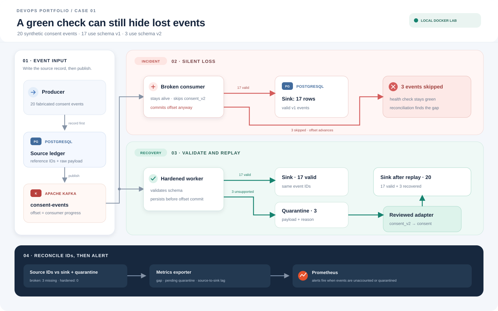

# Case 01 — Data flow

[English](#english) | [Bahasa Indonesia](#bahasa-indonesia)

## Read the diagram

The producer records each event in the source ledger before publishing it to Kafka. Both paths consume the same 20 synthetic events: 17 use `consent`, while 3 use `consent_v2`.

- **Red path — reproduce the incident:** the old consumer stays alive and commits all 20 offsets, but only 17 events reach the sink. Reconciliation detects the other 3 as unaccounted.
- **Green path — contain and recover:** the hardened consumer writes 17 supported events to the sink and places 3 unsupported events in quarantine. A reviewed adapter maps `consent_v2` to `consent`; replay fills the sink to 20 rows.
- **Bottom row — prove delivery:** reconciliation compares source IDs with sink and pending quarantine IDs. The metrics exporter exposes the gap and quarantine counts to Prometheus alerts.

Kafka and PostgreSQL do not share one atomic transaction. The worker persists a sink or quarantine outcome before committing that specific Kafka offset. If it crashes in between, Kafka can redeliver; the sink's `(run_id,event_id)` key makes that repeat safe. The lab demonstrates at-least-once delivery with idempotent writes, not exactly-once processing across both systems.

See the [run guide](build-and-run.md) for commands and [test evidence](test-evidence.md) for the measured results.

## Case 01 — Alur data

## Membaca diagram

Producer mencatat setiap event ke source ledger sebelum menerbitkannya ke Kafka. Kedua jalur menerima 20 event sintetis yang sama: 17 memakai `consent`, sedangkan 3 memakai `consent_v2`.

- **Jalur merah — mereproduksi insiden:** consumer lama tetap hidup dan mengomit seluruh 20 offset, tetapi hanya 17 event yang masuk ke sink. Rekonsiliasi menemukan 3 event tidak terhitung.
- **Jalur hijau — menahan dampak dan memulihkan:** consumer hardened menulis 17 event yang didukung ke sink dan menempatkan 3 event yang belum didukung di karantina. Adapter yang sudah ditinjau memetakan `consent_v2` ke `consent`; replay melengkapi sink menjadi 20 baris.
- **Baris bawah — membuktikan pengiriman:** rekonsiliasi membandingkan ID sumber dengan ID sink dan karantina yang masih tertunda. Metrics exporter mengirim jumlah gap dan karantina ke alert Prometheus.

Kafka dan PostgreSQL tidak berbagi satu transaksi atomik. Worker menyimpan hasil sink atau karantina sebelum mengomit offset Kafka terkait. Jika proses crash di antaranya, Kafka dapat mengirim ulang; kunci `(run_id,event_id)` pada sink membuat pengulangan aman. Lab menunjukkan pengiriman at-least-once dengan penulisan idempotent, bukan exactly-once lintas dua sistem.

Lihat [panduan build dan run](build-and-run.md) untuk perintah serta [bukti pengujian](test-evidence.md) untuk hasil terukur.
