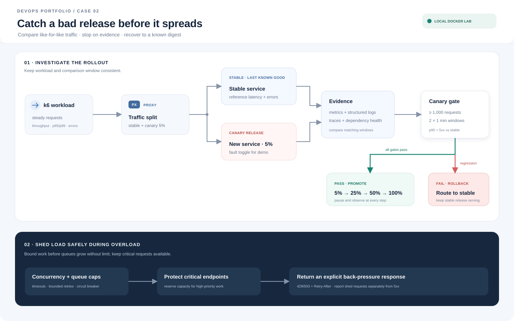

# Case 02 — Incident Recovery

[English](#english) | [Bahasa Indonesia](#bahasa-indonesia)

> **English:** The optional [Kubernetes manifests](docs/kubernetes.md) let learners run this case with Deployments and Services. Docker Compose remains the default local path.

## English

### Purpose
Handle a deployment that increases latency and errors through evidence-based investigation, canary rollout, rollback, and load shedding.

### Docker lab architecture
Docker Compose runs a weighted router, stable and canary services, PostgreSQL, a k6 load generator, and Prometheus. Latency and error metrics are separated by release, and requests are logged as JSON. `labctl.py` checks Prometheus gates before staged promotion and sends all traffic back to stable during rollback. Fault toggles simulate latency, slow database queries, or errors.

### Demo scenario
1. Run a fixed baseline workload and record throughput, p95/p99, error rate, and dependency utilization.
2. Deploy a faulty version to the 5% canary and mark the deployment time.
3. Compare metrics, structured logs, and database query timings to distinguish an application regression from a slow dependency.
4. Stop promotion when a gate fails, route traffic back to stable, and verify recovery.
5. Increase load to demonstrate bounded concurrency and queues. Shed low-priority requests with 429/503 and `Retry-After` while protecting critical work.
6. Release the fix in stages: 5% → 25% → 50% → 100%, observing each stage.

### Operational policy and investigation
The demo target is p95 below 300 ms and 5xx below 1% under a recorded baseline workload. A canary gate fails above 1% errors or 120% of stable p95 for two one-minute windows. Each window needs at least 1,000 total requests and 1,000 served canary requests; load-shed responses do not count as canary evaluation samples. Insufficient samples hold promotion. Compare stable and canary under comparable load and report load-shed responses separately from internal errors. The router and services apply bounded concurrency; the router rejects excess work before it can build a long upstream queue.

Use timeouts, circuit breakers, bounded retries with jitter, and queue limits to avoid retry storms. The demo rollback routes traffic to the still-running stable service. Production rollback should select the last known-good image digest. Database changes need backward-compatible expand/contract migrations; destructive changes should not enter an automatic rollback path.

Record impact and event time, inspect the last change, compare canary with stable, investigate dependencies and saturation, stop rollout, roll back, verify metrics and synthetic transactions, then preserve the timeline and follow-up actions. Do not reset containers before collecting evidence.

### Success criteria and limits
The design target is to detect a regression within two minutes after enough samples are available, return traffic to stable within one minute of a rollback decision, recover latency/error targets, and shed overload without unbounded queue growth. These are planned thresholds, not benchmark claims. The local Docker lab is available; its workload results depend on the machine used.

See the [build and demo guide](docs/build-and-run.md) for Compose, k6, gates, and cleanup instructions. The optional [Kubernetes manifest guide](docs/kubernetes.md) covers the Deployment/Service variant. See [load-test evidence](docs/test-evidence.md) for test configuration, commands, raw output excerpts, and actual results compared with targets.

### Validation performed

These checks validate the manifest files and render the base Kustomize configuration; they do not demonstrate a running Kubernetes workload.

| Check | Actual result |
| --- | --- |
| `kubectl kustomize kubernetes/` | Passed; rendered 12 Kubernetes resource documents. |
| Ruby YAML parser on `kubernetes/*.yaml` | Passed; parsed all six YAML files (14 YAML documents including the optional k6 Job and Kustomization). |
| `git diff --check` | Passed; no whitespace errors. |
| `kubectl config current-context` | Not available; kubectl reports `error: current-context is not set`. |
| `docker info --format '{{.OSType}}/{{.Architecture}}'` | Could not reach Docker daemon; permission denied for `~/.docker/run/docker.sock`. |

**Runtime outcome:** Kubernetes deployment, HTTP checks, k6 workload, and rollback were not run. There is no configured Kubernetes context, and Docker daemon access is unavailable. The resource and performance targets above remain design targets; this validation produced no runtime or load-test measurements.

## Tujuan
Menangani deployment yang menaikkan latensi dan error melalui investigasi berbasis bukti, canary, rollback, serta load shedding.

## Arsitektur Docker lab
Docker Compose menjalankan router berbobot, aplikasi stable dan canary, PostgreSQL, generator beban k6, serta Prometheus. Metrik latency dan error dibedakan menurut release; log request berbentuk JSON. `labctl.py` mengukur gate Prometheus sebelum promosi bertahap dan mengembalikan traffic ke stable saat rollback. Canary memiliki fault toggle untuk simulasi latensi, query lambat, atau error.

## Skenario demo
1. Jalankan baseline dengan workload tetap dan simpan throughput, p95/p99, error rate, serta utilisasi dependency.
2. Rilis versi bermasalah ke canary 5%. Tandai waktu deployment di dashboard.
3. Investigasi metrik, log terstruktur, dan waktu query database untuk membedakan regresi aplikasi dari perlambatan dependency.
4. Hentikan promosi saat gate gagal; alihkan traffic kembali ke stable dan verifikasi pemulihan.
5. Naikkan beban untuk menunjukkan load shedding: batasi concurrency dan antrean, tolak request prioritas rendah dengan 429/503 dan `Retry-After`, serta pertahankan endpoint kritis.
6. Rilis perbaikan melalui tahap 5% → 25% → 50% → 100%, dengan observasi di setiap tahap.

## Kebijakan operasional
- Target demo: p95 < 300 ms dan error 5xx < 1% pada workload baseline yang dicatat.
- Gate canary gagal jika error > 1% atau p95 > 120% baseline stable selama dua jendela satu menit. Setiap jendela membutuhkan minimal 1.000 request total dan 1.000 request canary yang dilayani; respons load shedding tidak dihitung sebagai sampel canary. Sampel yang kurang menahan promosi.
- Bandingkan stable dan canary pada workload sebanding. Pisahkan respons load shedding dari error internal agar dashboard tidak menyembunyikan penolakan pengguna.
- Terapkan timeout, circuit breaker, retry terbatas dengan jitter, serta batas antrean untuk mencegah retry storm.
- Demo rollback mengalihkan traffic ke service stable yang tetap hidup. Di produksi, rollback harus memilih digest stable terakhir. Migrasi database perlu kompatibel mundur dengan pola expand/contract; perubahan destruktif tidak masuk jalur rollback otomatis.

## Runbook investigasi
Catat dampak dan waktu kejadian → periksa perubahan terakhir → bandingkan canary/stable → telusuri dependency dan saturasi → hentikan rollout → rollback → verifikasi metrik serta transaksi sintetis → susun timeline dan tindakan pencegahan. Simpan bukti sebelum mereset container.

## Kriteria keberhasilan
Regresi terdeteksi maksimal dua menit setelah sampel cukup. Traffic kembali ke stable maksimal satu menit setelah keputusan rollback. Latensi/error kembali ke target, dan saat overload layanan menolak beban secara terkendali tanpa pertumbuhan antrean tak terbatas.

## Artefak
`compose.yaml`, stable/canary service, router, perintah gate/promote/rollback, skenario k6, Prometheus alerts, dan [panduan build dan demo](docs/build-and-run.md).

## Status
Docker lab lokal tersedia. Ambang operasional di atas adalah rancangan; benchmark dan uji beban bergantung pada mesin yang digunakan.

## Hasil validasi

Pemeriksaan berikut memvalidasi berkas manifest dan merender konfigurasi dasar Kustomize; ini belum membuktikan workload Kubernetes berjalan.

| Pemeriksaan | Hasil aktual |
| --- | --- |
| `kubectl kustomize kubernetes/` | Berhasil; menghasilkan 12 dokumen resource Kubernetes. |
| Parser YAML Ruby pada `kubernetes/*.yaml` | Berhasil; mem-parsing keenam berkas YAML (14 dokumen YAML termasuk Job k6 opsional dan Kustomization). |
| `git diff --check` | Berhasil; tidak ada kesalahan whitespace. |
| `kubectl config current-context` | Belum tersedia; kubectl melaporkan `error: current-context is not set`. |
| `docker info --format '{{.OSType}}/{{.Architecture}}'` | Tidak dapat mengakses Docker daemon; izin ke `~/.docker/run/docker.sock` ditolak. |

**Hasil runtime:** Deployment Kubernetes, pemeriksaan HTTP, workload k6, dan rollback belum dijalankan. Kubernetes context belum dikonfigurasi dan akses Docker daemon tidak tersedia. Target resource serta performa di atas masih berupa rancangan; validasi ini belum menghasilkan pengukuran runtime atau beban.
