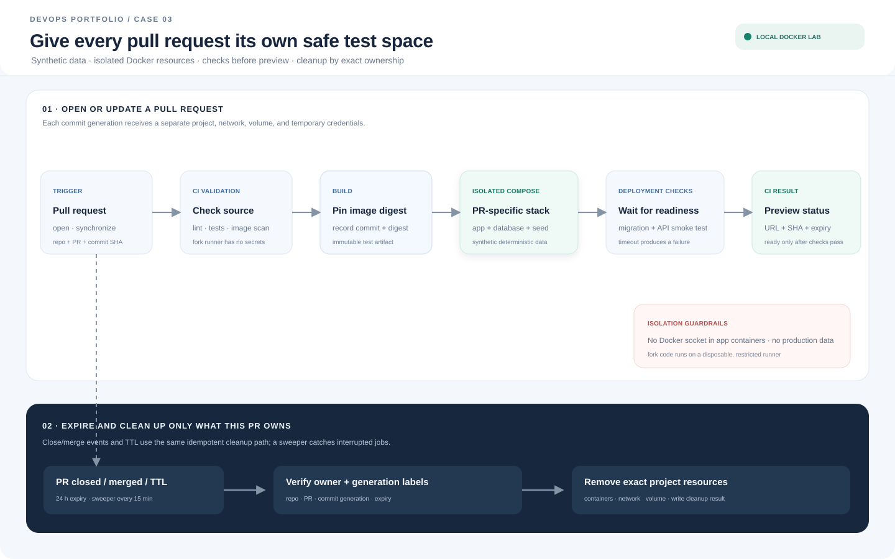

# Case 03 — Developer Platform

[Bahasa Indonesia](#bahasa-indonesia) | [English](#english)

## Tujuan
Menyediakan environment pengujian terisolasi untuk setiap pull request, menggunakan data sintetis, pemeriksaan deployment, dan cleanup otomatis.

## Arsitektur Docker lab
Template Compose membuat app, PostgreSQL, dan seed sintetis dalam project unik untuk nomor PR dan generasi. `envctl.py` memegang lock per PR, memeriksa readiness serta isi sintetis, lalu melaporkan URL localhost dan masa berlaku. Environment menggunakan network, volume, kredensial dummy, dan port sendiri. Tidak ada integrasi GitHub atau preview publik.

Jalur Kubernetes opsional tersedia di [`kubernetes/`](kubernetes/) dan [panduan deployment](docs/kubernetes.md). Contoh ini menyediakan satu namespace preview PR/generasi; cleanup namespace berbasis TTL otomatis memerlukan controller eksternal.

## Siklus hidup environment
1. PR dibuka atau diperbarui: validasi sumber, jalankan lint/test dan pemeriksaan image, lalu build image dengan digest yang dicatat.
2. Buat project Compose untuk commit tersebut dengan CPU/memory limit dan kuota jumlah environment.
3. Jalankan migrasi dan seed sintetis deterministik: akun palsu, transaksi contoh, serta kasus batas. Jangan menyalin data produksi.
4. Tunggu readiness database/aplikasi dengan timeout, jalankan smoke test API, pemeriksaan migrasi, serta tes alur utama.
5. Laporkan status, alamat preview, commit SHA, dan waktu kedaluwarsa sebagai hasil CI. Deployment gagal tidak boleh dilaporkan siap.
6. Saat PR ditutup, di-merge, atau melewati TTL, hapus resource milik environment itu. Job terjadwal merekonsiliasi resource yatim.

## Isolasi dan kontrol
- Kode PR diperlakukan tidak tepercaya. PR dari fork memakai runner sementara terisolasi tanpa secret produksi atau akses Docker host bersama.
- Hindari mount Docker socket ke container aplikasi. Orkestrasi Docker berjalan pada runner/host khusus yang dapat dibuang.
- Batasi network egress dan akses antar-environment; preview publik memerlukan autentikasi dan TLS.
- Label resource dengan owner, PR, generation, serta penanda pengelolaan TTL; waktu expiry disimpan pada state manager. Cleanup memakai project name persis, bukan wildcard atau `docker system prune`.
- Gunakan lock per PR. Job lama tidak boleh menimpa status atau menghapus environment generasi terbaru.
- Kredensial hanya berlaku untuk database preview; log dan artefak tidak memuat secret.

## Cleanup dan kegagalan
TTL awal 24 jam dan sweeper setiap 15 menit. Cleanup bersifat idempotent, menghapus container/network/volume yang terverifikasi milik environment, serta mencatat hasil. Kegagalan provisioning memicu cleanup dalam blok finalisasi; sweeper menangani runner yang terhenti sebelum finalisasi.

## Kriteria keberhasilan
Dua PR dapat aktif bersamaan tanpa berbagi data atau port. Target rancangan untuk menyiapkan environment sehat adalah lima menit; waktu aktual bergantung pada resource lokal dan belum ditetapkan sebagai benchmark. Kegagalan readiness menghasilkan status gagal beserta log. Penutupan PR dan TTL membersihkan semua resource terkait tanpa menyentuh PR lain; event CI ganda dan pembaruan bersamaan aman.

## Artefak
Template `compose.yaml`, Dockerfile, data sintetis, skrip provision/status/cleanup/sweep, [panduan build dan demo](docs/build-and-run.md), dan [bukti isolasi, generasi, TTL, serta cleanup](docs/test-evidence.md).

## Status
Docker lab lokal tersedia. Compose memisahkan network per project, tetapi template lokal ini tidak membatasi egress dan tidak menjalankan kode PR dari GitHub. Integrasi workflow, runner khusus untuk kode PR tidak tepercaya, autentikasi preview, pembatasan egress, dan TLS tetap di luar cakupan demo ini.

## English

### Purpose
Provide an isolated test environment for each pull request, with synthetic data, deployment checks, and automatic cleanup.

### Docker lab architecture
The Compose template creates an app, PostgreSQL, and synthetic seed data in a unique project for each PR and generation. `envctl.py` uses a per-PR lock, checks readiness and the synthetic records, then reports a localhost URL and expiry time. Each environment has its own network, volume, dummy credentials, and port. There is no GitHub integration or public preview.

An optional Kubernetes example is available under [`kubernetes/`](kubernetes/) with a [deployment guide](docs/kubernetes.md). It provisions one PR/generation namespace; automatic TTL-based namespace cleanup requires an external controller.

### Environment lifecycle
1. When a PR opens or updates, validate its source, run lint/tests and image checks, then build an image with a recorded digest.
2. Create an isolated Compose project for the commit, with CPU/memory limits and an environment quota.
3. Run migrations and deterministic synthetic seeds, including fake accounts, sample transactions, and edge cases. Never copy production data.
4. Wait for database and app readiness with timeouts, then run API smoke checks, migration checks, and critical-flow tests.
5. Report status, preview URL, commit SHA, and expiry time to CI. A failed deployment must not be reported as ready.
6. When a PR closes, merges, or reaches its TTL, remove only its resources. A scheduled job reconciles orphaned resources.

### Isolation and controls
Treat PR code as untrusted. Fork PRs need temporary isolated runners without production secrets or shared host Docker access. Do not mount the Docker socket into app containers. Limit network egress and cross-environment access; public previews need authentication and TLS. Label resources with owner, PR, generation, and TTL-management metadata. Store expiry in the state manager. Cleanup uses an exact project name, never a wildcard or `docker system prune`. Per-PR locks prevent stale jobs from replacing or deleting newer generations. Preview credentials are scoped to the preview database, and logs/artifacts must not contain secrets.

The initial TTL is 24 hours with a sweeper every 15 minutes. Cleanup is idempotent and records its result. Provisioning failures trigger cleanup; the sweeper handles runners interrupted before finalization.

### Success criteria and limits
Two PR environments should run concurrently without sharing data or ports. The design target for a healthy environment is five minutes; actual startup depends on local resources and is not reported as a benchmark. Failed readiness should report failure and logs. PR closure and TTL should clean up only matching resources; duplicate CI events and concurrent updates should be safe.

The local lab provides the Compose template, Dockerfile, synthetic data, and provision/status/cleanup/sweep commands. It separates Compose networks but does not block outbound egress or execute GitHub PR code. Workflow integration, isolated runners for untrusted code, authenticated previews, egress restrictions, and TLS are outside this demo's scope. See the [build and run guide](docs/build-and-run.md) and [recorded isolation and cleanup evidence](docs/test-evidence.md).
