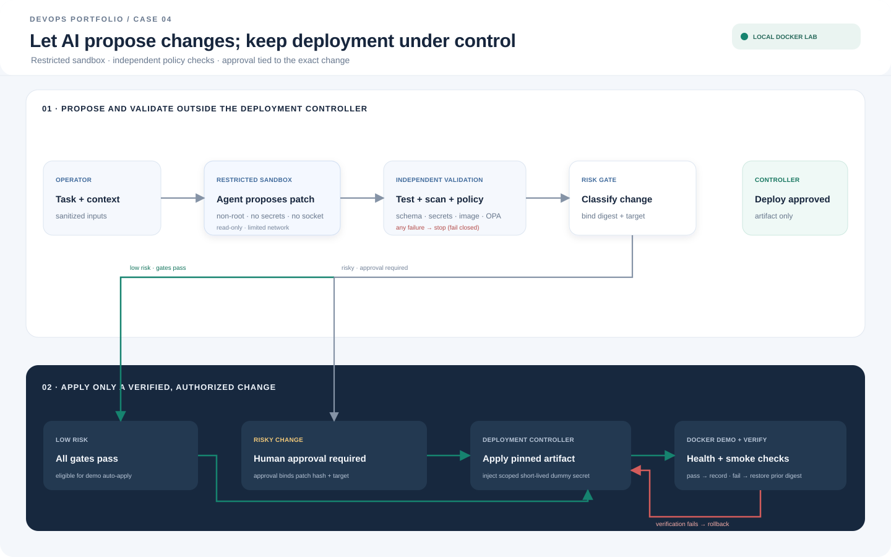

# Case 04 — Safe AI Deployment

[Bahasa Indonesia](#bahasa-indonesia) | [English](#english)

## Tujuan
Mendemonstrasikan AI yang membantu menyusun perubahan deployment, dengan sandbox, policy gate, pembatasan secret, dan persetujuan manusia untuk perubahan berisiko.

## Arsitektur Docker lab
Docker Compose menjalankan agent fixture deterministik tanpa jaringan, policy evaluator OPA, deployment controller, dan target aplikasi mock. Agent hanya menulis proposal ke volume; controller di luar sandbox meminta keputusan OPA, memerlukan hash approval untuk perubahan berisiko, lalu memanggil API target. Docker socket tidak dipasang ke container mana pun.

## Alur perubahan
1. Operator memberi tugas dan konteks tersanitasi. File repo, log, serta output tool diperlakukan sebagai data tidak tepercaya, termasuk instruksi yang mencoba mengubah policy.
2. Agent menyusun diff dan rencana di sandbox non-root: filesystem utama read-only, workspace sementara, capability di-drop, resource limit, serta tanpa Docker socket/host mount.
3. Network sandbox ditutup secara default; kebutuhan fetch memakai allowlist dan dependency yang dipin.
4. Validator di luar kendali agent memeriksa schema konfigurasi, test, secret scan, dependency/image scan, serta policy-as-code.
5. Controller menghasilkan ringkasan diff, target environment, digest image, hasil pemeriksaan, dampak, dan rencana rollback.
6. Perubahan berisiko meminta persetujuan manusia yang mengikat hash artefak dan target. Perubahan setelah persetujuan membatalkan persetujuan tersebut.
7. Controller menerapkan artefak tervalidasi ke environment Docker demo, menjalankan health/smoke check, dan rollback jika verifikasi gagal.

## Policy dan klasifikasi risiko
- Tolak privileged container, mount host/Docker socket, image tanpa digest, egress terlarang, dan akses secret di luar scope. Persetujuan biasa tidak melewati larangan mutlak ini.
- Wajib persetujuan untuk migrasi database, penghapusan resource/data, perubahan IAM/network, kenaikan resource di atas batas, dan deployment ke target sensitif.
- Perubahan rendah risiko boleh otomatis hanya setelah seluruh gate lulus dalam environment demo yang diizinkan.
- Agent tidak boleh mengubah policy evaluator, aturan persetujuan, atau pipeline controller. Kegagalan evaluator dan hasil tidak lengkap menghentikan deployment (fail closed).

## Secret dan audit
Secret hanya diinjeksi ke controller/runtime yang memerlukannya, dengan scope minimum dan masa berlaku singkat. Secret tidak masuk prompt, image, diff, maupun log. Gunakan nilai dummy pada demo, redaksi output, dan pemindaian artefak. Catat task ID, hash input/patch, keputusan policy, identitas approver, target, digest image, serta hasil deployment; agent tidak memiliki hak mengubah audit log.

## Skenario demo dan kriteria keberhasilan
- Perubahan konfigurasi aman lulus test/policy dan berhasil diterapkan ke aplikasi demo.
- Permintaan privileged mode atau eksfiltrasi secret ditolak sebelum eksekusi.
- Prompt injection dalam file repo tidak dapat mengubah policy atau menjalankan deployment langsung.
- Perubahan migrasi tertahan sampai ada persetujuan; mengedit patch sesudah persetujuan membuatnya tidak berlaku.
- Policy service tidak tersedia menyebabkan deployment tertahan. Health check gagal memicu rollback ke digest sebelumnya yang kompatibel dengan schema database.
- Seluruh keputusan dapat ditelusuri melalui audit tanpa membocorkan secret. Sandbox container tetap memiliki keterbatasan isolasi kernel; workload tak tepercaya pada implementasi nyata ditempatkan di runner/VM sementara khusus.

## Artefak
`compose.yaml`, image sandbox/controller, policy Rego, fixture allow/deny, hash approval, target mock, secret dummy, audit lokal, [panduan build dan demo](docs/build-and-run.md), dan [bukti approval, fail-closed, rollback, serta konfigurasi sandbox](docs/test-evidence.md).

## Status
Docker lab lokal tersedia. Agent adalah fixture deterministik, bukan model AI; seluruh secret adalah placeholder dan target hanya simulasi lokal. Ini mendemonstrasikan gerbang kontrol, bukan isolasi produksi terhadap kode berbahaya.

## English

### Purpose
Demonstrate deployment changes assisted by an AI-style proposal flow, with sandboxing, policy gates, secret restrictions, and human approval for risky changes.

### Docker lab architecture
Docker Compose runs a deterministic fixture agent without network access, an OPA policy evaluator, a deployment controller, and a mock application target. The agent only writes a proposal to a shared volume. The controller runs outside the sandbox, requests an OPA decision, requires a hash-bound approval for risky changes, then calls the target API. No container receives the Docker socket.

### Change flow
1. The operator provides a task and sanitized context. Repository files, logs, and tool output are untrusted data, including text that attempts to change policy.
2. A non-root sandbox prepares a diff and plan with a read-only root filesystem, temporary workspace, dropped capabilities, resource limits, and no Docker socket or host mounts.
3. Sandbox networking is disabled by default; any required fetch uses an allowlist and pinned dependencies.
4. Validators outside agent control check configuration schema, tests, secrets, dependencies/images, and policy-as-code.
5. The controller summarizes the diff, target environment, image digest, checks, impact, and rollback plan.
6. Risky changes require human approval bound to the artifact hash and target. Any change after approval invalidates it.
7. The controller applies a validated artifact to the Docker demo environment, runs health/smoke checks, and rolls back if verification fails.

### Policy, risk, secrets, and audit
Reject privileged containers, host/Docker socket mounts, images without digests, forbidden egress, and out-of-scope secret access. Ordinary approval cannot override these hard denials. Require approval for database migrations, resource/data deletion, IAM/network changes, resource increases beyond limits, and sensitive targets. Low-risk changes may run automatically only after every gate passes in an allowed demo environment. The agent cannot edit the policy evaluator, approval rules, or controller pipeline. Missing policy results fail closed.

Inject secrets only into the controller/runtime that needs them, with minimum scope and short lifetime. Secrets must not appear in prompts, images, diffs, or logs. The demo uses dummy values, redacts output, and scans artifacts. Audit records include task ID, input/patch hash, policy decision, approver identity, target, image digest, and deployment result; the agent cannot change the audit log.

### Demo checks and limits
Safe changes should pass tests/policy and reach the mock app. Privileged-mode and secret-exfiltration proposals must be denied before execution. Repository prompt-injection text must not alter policy or directly deploy. Risky migrations wait for approval; changing an approved patch invalidates its approval. An unavailable policy service blocks deployment. Failed health checks trigger rollback to the prior schema-compatible digest. Audit records should remain traceable without exposing secrets.

The Docker lab includes the sandbox/controller image, Rego policy, allow/deny fixtures, hash approvals, mock target, dummy secrets, and local audit. The agent is deterministic fixture code, not an AI model. Secrets are placeholders and the target is local only. Containers share the host kernel, so this is not a production sandbox for arbitrary malicious code. See the [build and run guide](docs/build-and-run.md) and [recorded approval, fail-closed, rollback, and sandbox evidence](docs/test-evidence.md).
